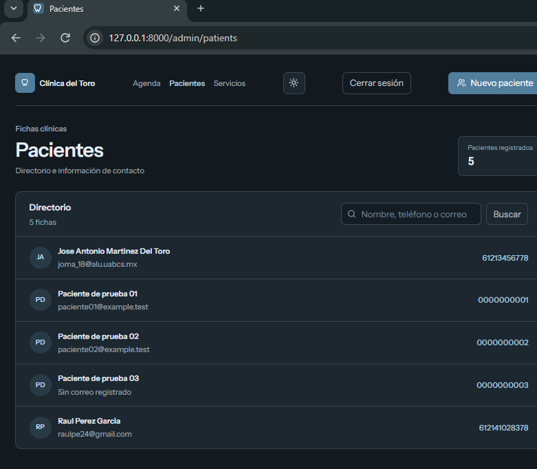

# Flujos de Trabajo y Casos de Uso — Citas Dentales

> Documento que describe los flujos de trabajo, casos de uso y acciones por rol dentro del sistema de programación de citas dentales.

---

## 1. Roles y Acceso

### 1.1 Roles disponibles

| Rol | Descripción | Acceso |
|-----|-------------|--------|
| **Paciente (visitante)** | Usuario externo que desea agendar una cita | Página pública de reserva, portal privado con token |
| **Personal administrativo** | Empleado del consultorio que gestiona la agenda | Panel `/admin` con credenciales |
| **Administrador** | Personal con permisos completos de gestión | Panel `/admin` + gestión de servicios, odontólogos, horarios, pacientes, citas y evaluaciones |

### 1.2 Credenciales de acceso (modo desarrollo)

**Acceso como personal/administrador:**

| Campo | Valor |
|-------|-------|
| Email | `admin@clinicadental.com` |
| Contraseña | `password` |
| URL | `http://127.0.0.1:8000/login` |

> **Nota:** El usuario administrador debe existir en la base de datos en la tabla `users` con `is_admin = true`. Si no existe, el acceso al panel administrativo no es posible. Para crear un usuario admin, inserte directamente en la base de datos:
>
> ```sql
> INSERT INTO users (name, email, password, is_admin, created_at, updated_at)
> VALUES ('Administrador', '', '$2y$10$hashed_password', 1, NOW(), NOW());
> ```
>
> Use `php artisan tinker` y `Hash::make('password')` para generar el hash.

---

## 2. Flujo de Usuario — Paciente

### 2.1 Flujo principal: Programar una cita (T01–T05)

```
Inicio
  ↓
Servicio
  ↓
Odontólogo
  ↓
Fecha
  ↓
Horario disponible
  ↓
Datos de contacto
  ↓
Confirmación
  ↓
Referencia de cita (CDT-XXXXXX)
```

#### Caso de Uso CO-01: Agendar limpieza dental

**Actor:** Paciente (visitante)

**Precondiciones:**
- Existen servicios activos en la base de datos
- Existen odontólogos con horarios activos
- No hay citas previas que bloqueen los horarios

**Flujo principal:**

1. El paciente navega a `http://127.0.0.1:8000/` (ruta `booking.start`)
2. La página carga todos los **servicios activos** (`is_active = true`) ordenados por `sort_order` y `name`
3. El paciente selecciona **"Limpieza dental"** (duración: 45 min, buffer: 15 min)
   - Se guarda `service_id` en el formulario Inertia
   - Se navega a `/?service_id=3&date=FECHA&dentist_id=DENTISTA`
4. El paciente selecciona un **odontólogo** del `<select>`
   - Se cargan los slots disponibles para esa combinación
5. El paciente selecciona una **fecha** usando `<input type="date">`
   - La fecha mínima es `now() + 24 horas` (configurado en `clinic.minimum_advance_hours`)
   - Los slots se recalculan para esa fecha
6. El paciente ve la **lista de horarios disponibles** (ej: 08:00, 08:30, 09:00, ..., 17:30)
   - Cada slot tiene en cuenta: duración del servicio + buffer + horario del odontólogo
   - Los slots ocupados por citas `scheduled` o `confirmed` se ocultan
7. El paciente selecciona un **horario** (slot)
   - Se guarda `starts_at` en el formulario
   - Avanza al paso 3 (datos de contacto)
8. El paciente ingresa:
   - **Nombre completo** (obligatorio, max 160)
   - **Teléfono** (obligatorio, max 32)
   - **Correo electrónico** (opcional, max 255)
9. El paciente revisa el **resumen** en el paso de confirmación:
   - Servicio, odontólogo, fecha, horario, nombre, teléfono
10. El paciente confirma → POST a `/reservar` (ruta `booking.store`)

**Postcondiciones:**
- Se crea una nueva cita con estado `scheduled`
- Se genera un token de acceso privado para el paciente
- Se muestra referencia `CDT-XXXXXX`

#### Caso de Uso CO-02: Servicio restringido requiere valoración (T02)

**Actor:** Paciente (visitante)

**Precondiciones:** El servicio "Restauración simple" está configurado con `requires_assessment = true`

**Flujo principal:**

1. El paciente navega a la página de reserva
2. Elige "Restauración simple" (60 min, requiere valoración)
3. El botón del servicio está **deshabilitado** y muestra: "Requiere valoración previa"
4. El paciente hace clic en **"Reservar valoración primero"**
5. Navega a `/?service_id=1` (Valoración general, 30 min)
6. Se cargan slots para la valoración
7. El paciente completa la reserva de la valoración

**Validación server-side (`StorePublicAppointmentRequest`):**
- `service_id` debe cumplir `requires_assessment = 0`
- Si falla → error: "El servicio ya no está disponible o requiere una valoración previa."

#### Caso de Uso CO-03: Fecha sin horarios (T03)

**Actor:** Paciente (visitante)

**Flujo alternativo:**

1. El paciente selecciona una fecha
2. El sistema verifica horarios del odontólogo para ese día
3. Si no hay horario (día de descanso, fin de semana, etc.) → `slots = []`
4. Mensaje: "No hay horarios para esta fecha. Prueba otro día de atención."
5. El paciente selecciona otra fecha

#### Caso de Uso CO-04: Consultar y cancelar cita (T04)

**Actor:** Paciente (con token de portal)

**Precondiciones:** El paciente tiene una sesión de reserva activa o el token de acceso

**Flujo principal:**

1. El paciente navega a `/mis-citas` o `/mis-citas/{token}`
2. El `PatientPortalController::index` valida el token con `hash_equals()`
3. Se muestran las citas con estado `scheduled` o `confirmed` para la fecha actual y futuras
4. El paciente ve su cita y hace clic en "Cancelar"
5. Se envía POST a `/mis-citas/{appointment}/cancelar`
6. `PatientPortalController::cancel` verifica:
   - Que la cita pertenece al paciente en sesión
   - Que quedan más de 24 horas (`starts_at > now()->addHours(24)`)
7. Si OK → cambia estado a `cancelled`, elimina acceso portal, flash `success`
8. La cita cancelada libera el horario

#### Caso de Uso CO-05: Cancelación tardía (T05)

**Actor:** Paciente (con token)

**Flujo alternativo:**

1. El paciente intenta cancelar una cita con menos de 24 horas
2. `PatientPortalController::cancel` lanza el error:
   "Debes contactar al consultorio para cancelar con menos de 24 horas de anticipación."
3. La cita mantienen estado `scheduled`
4. El paciente debe contactar al consultorio directamente

#### Caso de Uso CO-06: Revocar enlace privado

**Actor:** Paciente (con token)

**Flujo principal:**

1. El paciente navega a `/mis-citas`
2. Hace clic en "Revocar acceso" (o POST a `/mis-citas/salir`)
3. Se eliminan todos los `PatientPortalAccess` del paciente
4. Se destruye la sesión de reserva
5. Redirección a la página de inicio con mensaje

---

## 3. Flujo de Usuario — Personal/Administrador

### 3.1 Autenticación (T06)

#### Caso de Uso CO-07: Iniciar sesión

**Actor:** Personal/administrador

**Precondiciones:** El usuario debe existir en la tabla `users` con `is_admin = true`

**Flujo principal:**

1. El personal navega a `/login`
2. Ingresa email y contraseña
3. El `AuthController::store` valida credenciales con `Auth::attempt()`
4. Si es administrador (`is_admin = true`) → redirige a `/admin`
5. Si no es administrador → error "Credenciales incorrectas"

**Credenciales de prueba:**

| Email | Password |
|-------|----------|
| `admin@clinicadental.com` | `password` |

#### Caso de Uso CO-08: Cerrar sesión

**Flujo principal:**

1. El admin hace clic en "Cerrar sesión"
2. POST a `/admin/logout`
3. `AuthController::destroy` llama a `Auth::logout()`
4. Se invalida la sesión y regenera el token
5. Redirige a `/login`

### 3.2 Gestión de agenda (Dashboard)

#### Caso de Uso CO-09: Visualizar agenda del día

**Actor:** Administrador

**Flujo principal:**

1. El admin navega a `/admin` o `/admin?date=2026-10-20`
2. `AppointmentController::index` valida la fecha (formato Y-m-d)
3. Carga citas para esa fecha con `with('patient:id,name,phone')`
4. Muestra: cita, paciente, odontólogo, servicio, horario, duración, estado
5. Carga estadísticas: total, scheduled, confirmed, completed, no_show

#### Caso de Uso CO-10: Crear cita manualmente

**Flujo principal:**

1. El admin hace clic en "Nueva cita" en la esquina superior derecha
2. Aparece un **formulario modal** con:
   - Paciente → select con búsquedas por nombre/teléfono
   - Odontólogo → lista de odontólogos activos (pre-seleccionado con el dentista filtrado en el dashboard)
   - Tratamiento → input libre para describir el servicio
   - **Fecha y hora** → datetime-local (vacío por defecto, el usuario debe seleccionar)
   - **Duración** → select con opciones: 15, 30, 45, 60, 90, 120 minutos
   - Notas → campo opcional para observaciones
3. Submit → POST a `/admin/appointments`
4. El controlador `AppointmentController::store`:
   - Usa `withDentistScheduleLock()` para transacción + lock optimista
   - Verifica disponibilidad con `isAvailableForDuration()`
   - Calcula `ends_at` usando `starts_at + duration_minutes` (cast a int)
   - Si OK → crea cita con estado `scheduled`, redirige al dashboard
   - Si conflicto → error: "Ese horario ya no está disponible..."
5. Al crear, la cita aparece en la agenda con etiqueta **Pendiente** (amarilla)

**Notas técnicas:**
- El `dentist_id` del formulario se inicializa con el dentista seleccionado en el filtro del dashboard
- La fecha/hora del formulario empieza vacía para obligar al usuario a seleccionar un horario específico
- La duración se envía como string del frontend → se castiga a int en el controlador
- El horario se verifica con lock de odontólogo + lock de schedule por día
- El estado inicial es siempre `scheduled` (debe ser confirmado por el admin)

### 3.3 Gestión de servicios

#### Caso de Uso CO-11: CRUD de servicios

**Actor:** Administrador

| Acción | Ruta | Controller |
|--------|------|------------|
| Listar | GET `/admin/services` | `ServiceController::index` |
| Crear | POST `/admin/services` | `ServiceController::store` |
| Editar | PUT `/admin/services/{service}` | `ServiceController::update` |
| Eliminar | DELETE `/admin/services/{service}` | `ServiceController::destroy` |

**Reglas:**
- Un servicio con citas asociadas **no se puede eliminar**, solo desactivar
- El slug se genera automáticamente con `Str::slug(name)` si está vacío
- `requires_assessment = true` deshabilita el servicio en la reserva pública

### 3.4 Gestión de odontólogos y horarios

#### Caso de Uso CO-12: Gestionar odontólogos

**Flujo principal:**

1. Admin navega a `/admin/schedules`
2. Ve lista de odontólogos con sus horarios semanales
3. Puede agregar un nuevo odontólogo con "Nuevo odontólogo"
4. Edita nombre y estado (activo/inactivo)
5. Configura horarios por día (lunes a domingo)

#### Caso de Uso CO-13: Actualizar horarios semanales

**Flujo principal:**

1. En cada tarjeta de odontólogo, hay un formulario con 7 filas
2. Cada fila: `weekday`, `is_open`, `opens_at`, `closes_at`
3. Si `is_open` está desmarcado → se elimina el horario
4. Si `is_open` está marcado → upsert del horario
5. PUT a `/admin/dentists/{dentist}/schedules`
6. Valida: 7 días únicos, `closes_at > opens_at`

### 3.5 Gestión de pacientes

#### Caso de Uso CO-14: Administrar pacientes

**Flujo principal:**

1. Admin navega a `/admin/patients`
2. Busca por nombre, teléfono o email
3. Paginación (12 por página)
4. Puede agregar nuevos pacientes con formulario

**Hipervínculos en la lista de pacientes:**

| Campo | Tipo de enlace | Propósito |
|-------|---------------|-----------|
| **Nombre del paciente** | `<Link href="/admin?patient_id={id}">` | Redirige al dashboard filtrado por ese paciente, mostrando todas sus citas y una tarjeta con sus datos completos |
| **Teléfono** | `<a href="tel:{phone}">` | Permite iniciar una llamada telefónica desde dispositivos móviles |

**Datos mostrados en el dashboard al filtrar por paciente:**

Cuando se selecciona un paciente en el dashboard, se muestra una tarjeta con:
- Nombre completo
- Teléfono (clic para llamar)
- Correo electrónico
- Fecha de nacimiento
- Notas clínicas (si existen)

Además, cada cita del paciente muestra:
- **Motivo**: el nombre del servicio (ej. "Valoración general", "Limpieza dental")
- Duración en minutos
- Notas de la cita (si existen)
- Estado actual con selector para cambiarlo

### 3.6 Cambio de estado de cita

#### Caso de Uso CO-15: Cambiar estado de una cita

**Actor:** Administrador

**Flujo principal:**

1. Admin navega a `/admin` y visualiza la agenda del día
2. En la tabla de citas, cada fila tiene un selector `<select>` de estado
3. Al seleccionar un estado del dropdown:
   - Se envía un **PATCH** a `/admin/appointments/{appointment}/status`
   - El cambio se aplica **inmediatamente** en la base de datos
   - La cita tiene el nuevo estado, no se filtra ni busca
4. El estado se refleja en tiempo real en la tabla

**Estados disponibles y transiciones:**

| Estado actual | Estado seleccionable | Notas |
|---------------|---------------------|-------|
| `scheduled` | `confirmed` | Confirmar que la cita está confirmada |
| `scheduled` | `cancelled` | Cancelar cita, liberar horario |
| `scheduled` | `no_show` | Paciente no asistió |
| `scheduled` | `completed` | Cambiar a completado |
| `confirmed` | `completed` | Finalizar cita |
| `confirmed` | `cancelled` | Cancelar después de confirmar |
| `confirmed` | `no_show` | Paciente no asistió |
| `completed` | — | Estado terminal, no editable |
| `cancelled` | — | Estado terminal, no editable |
| `no_show` | — | Estado terminal, no editable |

**Clarificación importante (según experiencia de usuario):**

⚠️ **El selector de estados NO filtra la agenda**. Al seleccionar un estado del dropdown, el sistema **asigna** ese estado a la cita seleccionada, **no filtra** las citas para mostrar solo las del estado elegido.

Si el admin quiere filtrar la agenda por estado, debe usar la funcionalidad de búsqueda con filtros avanzados o la tabla ya mostrada.

**Validación:**

- `UpdateAppointmentStatusRequest::after()` valida que las transiciones sean válidas
- Si se intenta cambiar de un estado terminal (`completed`, `cancelled`, `no_show`) → error de validación
- El horario de una cita `cancelled` se libera para nuevas reservas
- El horario de una cita `no_show` **no se libera** (se mantiene como histórico)

#### Caso de Uso CO-16: Marcar "no asistió"

**Flujo principal:**

1. Admin marca una cita como `no_show` desde el estado `scheduled` o `confirmed`
2. El estado `no_show` es **terminal**: no se puede reabrir ni cambiar
3. La cita no libera el horario (permanece como histórico)
4. Se actualiza el contador de estadísticas `no_show`

---

## 3.8 Acceso de Doctores (Odontólogos)

### ¿Los doctores tienen acceso al panel de administración?

**No automáticamente.** El sistema distingue dos entidades diferentes:

| Entidad | Tabla | Propósito | Acceso |
|---------|-------|-----------|--------|
| **Usuario** | `users` | Autenticación al panel admin | `/admin` si `is_admin = true` |
| **Dentista/Doctor** | `dentists` | Catálogo de odontólogos para agendar | Solo referencia en citas |

Un doctor **no tiene acceso al panel `/admin`** a menos que también se registre como usuario en la tabla `users` con `is_admin = true`. Los doctores existen como referencia en las citas (campo `dentist_id`, `dentist_name`), pero no tienen credenciales de login propias en el sistema actual.

### Cómo dar acceso a un doctor como administrador

Si un doctor necesita acceder al panel de administración:

1. Registrar al doctor como usuario en la tabla `users`:
   ```sql
   INSERT INTO users (name, email, password, is_admin, created_at, updated_at)
   VALUES ('Dr. Carlos Méndez', 'carlos.mendez@clinica.com', '$2y$10$hashed_password', 1, NOW(), NOW());
   ```
2. El doctor podrá acceder a `/login` con sus credenciales
3. Verá el mismo panel de administración que cualquier otro admin

### Casos de Uso para Doctores Registrados (CO-17 a CO-20)

#### Caso de Uso CO-17: Ver agenda propia

**Actor:** Doctor registrado como administrador

**Flujo principal:**

1. El doctor inicia sesión en `/login`
2. Redirige a `/admin` (panel de administración)
3. En el select "Odontólogo", selecciona su propio nombre
4. El sistema filtra la agenda para mostrar solo sus citas
5. Puede ver: paciente, servicio, horario, duración, estado de cada cita

#### Caso de Uso CO-18: Cambiar estado de sus propias citas

**Actor:** Doctor registrado como administrador

**Flujo principal:**

1. El doctor filtra su agenda por su nombre en el select de odontólogo
2. En cada cita de su agenda, usa el selector de estado
3. Opciones disponibles según el estado actual:
   - `scheduled` → `confirmed`, `completed`, `cancelled`, `no_show`
   - `confirmed` → `completed`, `cancelled`, `no_show`
4. Al cambiar el estado, se envía PATCH a `/admin/appointments/{id}/status`
5. La cita se actualiza inmediatamente

#### Caso de Uso CO-19: Ver historial de citas de un paciente

**Actor:** Doctor registrado como administrador

**Flujo principal:**

1. El doctor navega a `/admin/patients`
2. En la lista de pacientes, hace clic en el nombre de un paciente
3. El sistema redirige al dashboard filtrado por ese `patient_id`
4. El doctor ve todas las citas de ese paciente para la fecha seleccionada
5. Puede cambiar el estado de cualquier cita del paciente

#### Caso de Uso CO-20: Crear cita para un paciente

**Actor:** Doctor registrado como administrador

**Flujo principal:**

1. El doctor navega a `/admin`
2. Hace clic en "Nueva cita"
3. Selecciona paciente, odontólogo (puede ser él mismo o otro), servicio, fecha/hora, duración
4. El sistema verifica disponibilidad del odontólogo seleccionado
5. Si está disponible, crea la cita con estado `scheduled`
6. Redirige al dashboard con mensaje de éxito

---

### 3.7 Estado de inasistencia (F13)

---

## 4. Herramientas de Evaluación

### 4.1 Card Sorting (F14)

**URL:** `/evaluacion/card-sorting`

**Flujo:**

1. El participante navega a la URL
2. Ve 8 tarjetas de funcionalidades
3. Puede:
   - Arrastrar tarjetas entre categorías
   - Usar `<select>` por tarjeta (fallback teclado)
   - Agregar más categorías
   - Renombrar categorías
4. Envía la clasificación
5. Se valida que cada tarjeta esté en exactamente una categoría

**Tarjetas disponibles:**

| ID | Etiqueta |
|----|----------|
| `book_appointment` | Agendar una cita |
| `services` | Consultar servicios dentales |
| `patient_appointments` | Consultar mis citas |
| `cancel_appointment` | Cancelar una cita |
| `clinic_schedule` | Consultar horarios de atención |
| `staff_agenda` | Ver agenda de la clínica |
| `patients` | Administrar pacientes |
| `staff_services` | Administrar servicios |

### 4.2 Cuestionario SUS (F15)

**URL:** `/evaluacion/sus`

**Flujo:**

1. El participante navega a la URL
2. Responde 10 preguntas con escala 1-5
3. Se calcula la puntuación automáticamente (0-100)
4. Los resultados se guardan de forma anónima

### 4.3 Panel de resultados (Admin)

**URL:** `/admin/evaluaciones`

**Flujo:**

1. Solo administradores pueden acceder
2. Muestra:
   - Contador total de respuestas SUS
   - Promedio SUS (1 decimal)
   - Lista de clasificaciones Card Sorting recientes

---

## 5. Reglas de Negocio (Resumen)

| ID | Regla | Implementación |
|----|-------|----------------|
| RB01 | Un horario no puede ser reservado por dos pacientes simultáneamente | Lock distribuido + transacción + `lockForUpdate()` |
| RB02 | Una cita cancelada libera el horario | Exclusión de `cancelled` en cálculo de slots |
| RB03 | La duración del servicio determina los bloques | `duration_minutes + buffer_minutes` define el slot mínimo |
| RB04 | Anticipación mínima de 24h para reservar | `config('clinic.minimum_advance_hours') = 24` |
| RB05 | Cancelación permitida hasta 24h antes | `PatientPortalController::cancel` verifica `$appointment->starts_at > now()->addHours(24)` |
| RB06 | Cancelación tardía: contactar | Mensaje: "Debes contactar al consultorio..." |
| RB07 | Inasistencia registrada como estado | `no_show`, estado terminal |
| RB08 | Transiciones de estado controladas | `UpdateAppointmentStatusRequest::after()` valida matriz |
| RB09 | Servicios restringidos requieren valoración | `requires_assessment = 0` en validación + UI deshabilita |
| RB10 | Slot interval = 30 min | `config('clinic.slot_interval_minutes') = 30` |

---

## 6. Requisitos del Entorno

### 6.1 PHP

| Requisito | Versión |
|-----------|---------|
| PHP mínimo | 8.3.0 |
| PHP recomendado | 8.5.11 |
| Extensiones | mbstring, pdo, pdo_mysql, tokenizer, xml, ctype, json, bcmath, openssl |

### 6.2 Node.js

| Requisito | Versión |
|-----------|---------|
| Node.js | 18.x o superior |
| npm | 9.x o superior |
| Vite | 5.x |

### 6.3 Base de Datos

| Requisito | Detalle |
|-----------|---------|
| MySQL | 8.0+ |
| SQLite | Soportado para desarrollo |
| Configuración | `DB_CONNECTION=mysql`, `DB_HOST=127.0.0.1` |

### 6.4 Comandos de desarrollo

```bash
# Iniciar servidor Laravel (PHP 8.5)
php artisan serve --host=127.0.0.1 --port=8000

# Iniciar servidor Vite (frontend)
npm run dev

# Migraciones
php artisan migrate:fresh

# Ejecutar tests
php artisan test
```

---

## 7. Datos Iniciales Requeridos

La aplicación **requiere datos previos** en la base de datos para funcionar:

1. **Servicios activos**: Al menos con un servicio con `is_active = true`
2. **Odontólogos con horarios**: Al menos un odontólogo activo con horarios semanales (lunes a viernes)

Si no hay estos datos, **no se mostrarán horarios disponibles** al seleccionar una fecha.

**Verificar datos:**

```bash
# Verificar servicios
SELECT id, name, is_active FROM services;

# Verificar odontólogos
SELECT id, name, is_active FROM dentists;

# Verificar horarios
SELECT d.name AS odontologo, weekday, opens_at, closes_at 
FROM schedules s 
JOIN dentists d ON s.dentist_id = d.id;

# Verificar usuario admin
SELECT id, name, email, is_admin FROM users;
```
